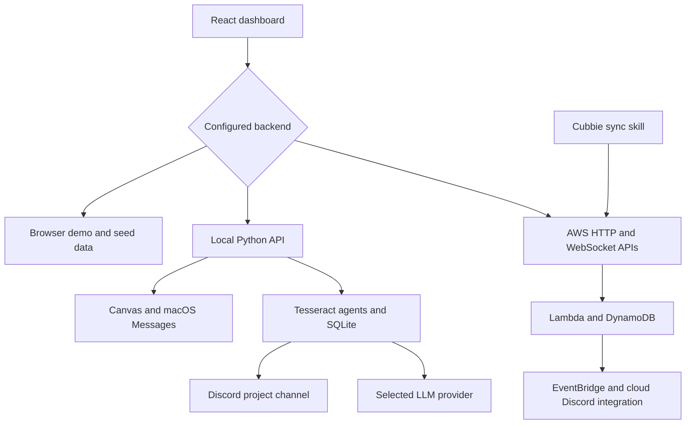

# Cubbie Dashboard + Tesseract

### One workspace for coursework, grading, job applications, and group projects.

Built for the **Cubbie Hackathon**, Cubbie Dashboard brings a student's scattered responsibilities into a Jira-style workspace alongside their Cubbie iMessage conversation. **Tesseract**, its Discord group-project assistant, turns rubrics and conversations into tasks, tracks dependencies, coordinates meetings, and helps teams follow through.

The goal is simple: **spend less time managing college work and more time doing it.**

[Quick start](#quick-start) · [Live integrations](#connect-real-accounts) · [Tesseract agents](#how-tesseract-works) · [Demo walkthrough](#hackathon-demo-walkthrough) · [Architecture](#architecture)

## The problem

College work is spread across Canvas deadlines, grading queues, job applications, iMessage conversations, and Discord channels. Students have to reconstruct what is due, who owns each task, and what is blocking the next step. In group projects, one teammate often becomes the unofficial project manager.

Cubbie Dashboard combines a visual personal task board with a conversational group-project assistant. It keeps coursework, grading, and job workflows distinct while giving students a shared place to see what needs attention.

## What we built

| Feature | What it does |
| --- | --- |
| **Coursework board** | Organizes assignments into Todo, In progress, and Submit columns, with task details and drag-and-drop updates. |
| **TA / grader workspace** | Separates grading work from student assignments, with submission counts when available and explicit grading deadlines. |
| **Job application tracker** | Tracks Applied, Assessment, Interview, Offer, and Closed stages, plus assessment dates and follow-ups. |
| **Board, list, and calendar views** | Offers different ways to inspect work, including a combined list across coursework, grading, and jobs. |
| **Cubbie chat** | Places the selected Cubbie iMessage conversation beside the dashboard when connected on a Mac. |
| **Canvas import** | Imports selected courses and assignments into the local board using the user's Canvas access. |
| **Cubbie sync skill** | Sends verified coursework, grading, and job records from Cubbie to the deployed dashboard. |
| **Tesseract Discord workspace** | Shows a project channel feed, tasks grouped by teammate, pending approvals, dependencies, meetings, and rubric requirements. |
| **Multi-agent coordination** | Uses specialized agents to plan work, resolve blockers, find meeting times, and manage follow-through. |

### What makes it different

- **Built around student roles:** coursework, TA responsibilities, job applications, and team projects have different workflows.
- **Conversations become structured work:** Tesseract can pick up explicit commitments and progress updates from project chat when passive listening is enabled.
- **People approve commitments:** assigning work to another member or proposing changes goes through approval rules rather than silently committing them.
- **Missing information stays missing:** unavailable counts are not treated as verified zeroes, student submission dates stay separate from grading deadlines, and imported application dates require evidence.
- **A visible reasoning trail:** agent actions and tool calls can be inspected through `/agents` and the Tesseract log channel.

## Choose a run mode

These are separate execution paths; not every integration is available in every mode.

| Mode | Best for | Requirements | Data and integrations |
| --- | --- | --- | --- |
| **Browser demo** | Exploring the UI without accounts | Node.js and pnpm | Fictional seed data, browser-persisted edits, and simulated board-aware chat. |
| **Local live** | Connecting personal accounts and demonstrating Tesseract | Node.js 24+, Python 3.10+, pnpm; macOS for iMessage | Canvas imports, the selected Cubbie Messages thread, and the local Tesseract Discord runtime. |
| **AWS deployment** | Hosting the dashboard and cloud integrations | AWS account, CDK tooling, and Docker for the optional Discord bot image | Cognito authentication, DynamoDB persistence, WebSocket updates, Cubbie skill ingestion, and cloud Discord reminders. |

**Tesseract's integrated group-project workspace currently runs through the local server. Deploying the AWS stack does not deploy that workspace's agent runtime.**

## Quick start

Use **Node.js 24+** for the full integrated project and **pnpm 9.12.3**, the version pinned in the workspace. The base dashboard declares Node.js 20+, but the Tesseract integration documentation requires Node.js 24+.

### 1. Clone and install

```bash
git clone https://github.com/sahana2k/Cubbie-hackathon.git
cd Cubbie-hackathon/cubbie-dashboard
corepack pnpm install
```

The commands below run from `cubbie-dashboard/`. Corepack must be available; otherwise install the pinned pnpm version and use `pnpm` in place of `corepack pnpm`.

### 2. Run the browser demo

```bash
corepack pnpm dev
```

Open **http://localhost:5173**. With no API connection configured, the app uses fictional seed data. No Canvas, Discord, AWS, or LLM credentials are needed for this mode.

Try moving cards, switching views, or asking the demo chat:

> What's due this week?
>
> What needs grading?
>
> Show my applications.

Demo chat is simulated; it does not contact Cubbie or send iMessages. Use **Demo data** in the top bar to reset the browser demo.

### 3. Run the local live dashboard

```bash
corepack pnpm build:tesseract
corepack pnpm live
```

Open **http://127.0.0.1:8787**. This builds the Tesseract service and frontend, then starts the Python local server. Keep the terminal running while using live integrations and scheduled Tesseract reminders.

For Canvas and iMessage without building Tesseract:

```bash
corepack pnpm --filter @cubbie/web build
python3 services/local/server.py
```

Local live mode starts without sample records and does not generate simulated Cubbie replies.

## Connect real accounts

### Canvas

1. Open **Settings** in the local live dashboard.
2. Enter your Canvas URL and a personal access token, if your institution permits API access.
3. Connect and confirm the account. Review the courses selected for the current term.
4. Choose **Student**, **TA / grader**, or **Skip** for each course, then import selected courses.

Canvas import is read-only toward Canvas. Board edits affect the local snapshot, not Canvas submissions or grades. Refresh imports manually; a later import may overwrite local edits. Choosing a grader role does not grant Canvas permissions.

The token stays in the local server's memory and must be re-entered after restart.

### Cubbie iMessage

1. Use a Mac where Messages already contains your Cubbie conversation.
2. In **Settings**, enter **Cubbie's** exact phone number or iMessage email.
3. Connect the thread. If access is denied, grant the terminal **Full Disk Access** and restart it.
4. Grant Messages automation permission when prompted to send a message.

The reader selects the configured one-to-one conversation. Sending from the live dashboard sends a real message; connecting does not send one automatically. A send confirmation is not a delivery or read receipt.

See the [local connection guide](cubbie-dashboard/docs/LOCAL-LIVE.md) for permissions, storage behavior, and troubleshooting.

### Discord and Tesseract

1. Create a dedicated bot in the [Discord Developer Portal](https://discord.com/developers/applications).
2. Enable **Message Content** and **Server Members** intents. Install it with `bot` and `applications.commands` scopes.
3. Grant View Channels, Read Message History, Send Messages, Embed Links, and Attach Files. Create `#tesseract-log` and give the bot access.
4. Open **Discord** in the local dashboard and enter the bot token and server ID.
5. Choose an LLM provider and enter its API key and an exact model ID that supports tool calling. Available adapters include Anthropic, OpenAI, Gemini, Groq, OpenRouter, and a custom HTTPS OpenAI-compatible endpoint.
6. Select the server and project channel. In Discord, run `/setup`, have teammates run `/join`, and upload the rubric with `/rubric`.

Connecting verifies the LLM configuration with a small tool-call request. PDF and image support depends on the selected provider and model. Use a dedicated bot because startup registers Tesseract's commands in the selected server.

The dashboard displays the channel feed and project state. Send messages, claim work, vote, and approve proposals **in Discord as yourself**. Tesseract supports server channels, not personal group DMs.

See [Tesseract setup and verification](cubbie-dashboard/docs/tesseract.md) for the full configuration.

## How Tesseract works

A router chooses the specialists needed for a message. They run in order, share project state in SQLite, and pass hand-off notes to one another. Tool implementations enforce approval and constraint checks.

| Agent | Responsibility |
| --- | --- |
| **Planner** | Extract rubric requirements, propose tasks, capture commitments, and create claimable work. |
| **Dependency Manager** | Track blockers, check dependency cycles, and propose deadline changes or reassignments when work slips. |
| **Meeting Coordinator** | Use private availability to propose meeting slots, collect votes, and produce calendar files. |
| **Accountability Manager** | Track progress, manage reminders, propose recovery actions, and check readiness and submission status. |
| **Assistant** | Answer direct questions using project context. |

For example, a message such as “I can't finish the research by Wednesday” can trigger dependency analysis and a proposed recovery plan. Affected members approve changes through Discord rather than the bot silently reassigning work.

### Useful Discord commands

| Commands | Purpose |
| --- | --- |
| `/setup`, `/join`, `/rubric` | Create a project, join the team, and import deliverables. |
| `/tasks`, `/mytasks`, `/status` | Inspect ownership and progress. |
| `/task`, `/claim`, `/done` | Create, claim, and complete work. |
| `/depends`, `/blocked` | Record and inspect dependencies. |
| `/classes`, `/meet` | Manage private availability and propose meetings. |
| `/rescue`, `/readiness`, `/submitted` | Propose recovery actions, check deliverables, and confirm submission. |
| `/settings`, `/agents`, `/help` | Adjust preferences, inspect agent activity, and see usage help. |

## Architecture



| Layer | Technologies |
| --- | --- |
| Frontend | React 18, TypeScript, Vite, CSS |
| Shared contracts | TypeScript domain types and Zod schemas |
| Local backend | Python standard-library HTTP server, SQLite, Canvas API, macOS Messages integration |
| Tesseract runtime | Node.js, TypeScript, discord.js, better-sqlite3, LLM tool calling, Luxon, chrono-node |
| Cloud backend | AWS Lambda, API Gateway HTTP/WebSocket APIs, DynamoDB and Streams |
| Hosting and authentication | S3, CloudFront, Amazon Cognito |
| Cloud scheduling and AI | EventBridge Scheduler, optional Amazon Bedrock weekly summaries |
| Infrastructure | AWS CDK; optional ECS Fargate Discord gateway bot |
| Tests | Node test runner, Vitest, Python unittest |

### Cubbie skill integration

The [cubbie-dashboard-sync skill](cubbie-dashboard/skills/cubbie-dashboard-sync/SKILL.md) packages facts already verified by Cubbie's existing workflows and posts them to `POST /ingest/cubbie` using a personal `x-cubbie-key`.

The cloud ingest handler validates batches and uses stable source IDs to update existing cards rather than creating duplicates. The skill does not independently provide Canvas, Gmail, or Cubbridge access; those upstream connections and workflows must already be available in Cubbie.

## Repository guide

All application code lives under `cubbie-dashboard/`.

| Path | Contents |
| --- | --- |
| `cubbie-dashboard/apps/web/` | Dashboard UI, demo/local/cloud API adapters, and frontend tests. |
| `cubbie-dashboard/packages/shared/` | Shared task types, schemas, and board definitions. |
| `cubbie-dashboard/services/local/` | Local server, Canvas import, Messages reader, and Tesseract process management. |
| `cubbie-dashboard/services/tesseract/` | Agents, Discord commands, consent rules, scheduling, and project persistence. |
| `cubbie-dashboard/services/api/` | Cloud HTTP, WebSocket, ingestion, stream, and reminder handlers. |
| `cubbie-dashboard/services/discord-bot/` | Separate AWS Discord gateway bot and command registration. |
| `cubbie-dashboard/agents/imessage-relay/` | macOS relay for the cloud dashboard. |
| `cubbie-dashboard/skills/cubbie-dashboard-sync/` | Installable Cubbie skill and Python push script. |
| `cubbie-dashboard/infra/` | AWS CDK infrastructure. |
| `cubbie-dashboard/docs/` | Architecture, deployment, and integration guides. |

## Development and checks

Run from `cubbie-dashboard/` after installing dependencies:

```bash
# Type-check all workspace packages
corepack pnpm typecheck

# Cloud API scheduler tests (the root test script covers this suite)
corepack pnpm test

# Frontend behavior tests
corepack pnpm --filter @cubbie/web test

# Tesseract agent, consent, scheduling, and provider tests
corepack pnpm test:tesseract

# Local integration and access-control tests using fixtures
corepack pnpm test:local

# Build all workspace packages
corepack pnpm build

# Generate a self-contained browser demo
corepack pnpm build:preview
```

The single-file demo is written to `apps/web/dist-preview/index.html`. Automated tests do not establish that real Canvas, Discord, iMessage, or LLM credentials work; verify those integrations separately in a test environment.

## Hackathon demo walkthrough

1. **Show the personal dashboard.** Switch between coursework, grading, and jobs; move a card and inspect the list and calendar views. Use browser demo mode for a credential-free introduction.
2. **Show the connected workflow.** In local live mode, import a permitted Canvas course or open the configured Cubbie conversation.
3. **Create a team project.** Connect Tesseract, run `/setup`, join with at least two Discord members, and upload a sample rubric.
4. **Turn chat into tasks.** Make a self-commitment, then propose work for another teammate and show their approval step.
5. **Demonstrate a blocker.** Record a dependency, report that an upstream task will be late, and review the proposed recovery action.
6. **Coordinate and verify.** Propose a meeting, inspect `/readiness`, and open `/agents` or `#tesseract-log` to explain what the agents did.

Prepare the bot, credentials, permissions, and test accounts before the live demo. Keep fictional demo data clearly separate from connected account data.

## AWS deployment

The repository includes an AWS CDK stack for the cloud dashboard. Configure the stack context, AWS credentials, authentication, and optional Discord integration using the [deployment guide](cubbie-dashboard/docs/DEPLOY.md).

From `cubbie-dashboard/`:

```bash
corepack pnpm build
cd infra
corepack pnpm exec cdk bootstrap
corepack pnpm exec cdk deploy
```

Deployment creates AWS resources and may incur charges. Cloud iMessage access requires the separate [macOS relay](cubbie-dashboard/agents/imessage-relay/README.md). Optional Bedrock summaries require a model enabled in the deployment region.

Workflow files currently live under `cubbie-dashboard/.github/workflows/`. To activate GitHub Actions for this repository layout, move them to the repository-root `.github/workflows/` and update working directories and relevant paths.

## Privacy and current boundaries

- The local server is intended for personal, loopback-only use. Do not expose it through a public tunnel.
- In dashboard-managed local mode, Canvas tokens stay in memory; Discord and LLM credentials are passed to the child runtime without being persisted in connection configuration. Reconnect after restarting.
- Task snapshots and project records persist locally under `~/.config/cubboard-dashboard/`. Keep personal data and credentials out of the repository.
- Project context is sent to the selected LLM provider. Private class labels are omitted from dashboard snapshots and public meeting suggestions.
- Local Canvas imports require manual refresh. Job tracking does not automatically connect an email account; live imported job records depend on the configured upstream Cubbie workflows.
- The coursework Todo filter focuses on published assignments due from today through day 15; it is not a complete Canvas assignment archive.
- Tesseract reminders require its process to remain running. Disconnecting or stopping the local server stops the dashboard-managed bot and reminders.
- This is a hackathon prototype with separate demo, local, and cloud paths. A shared hosted version of the local Tesseract integration remains future work.

## Possible next steps

- Add a hosted, multi-user Tesseract service with per-team authentication.
- Introduce institution-approved Canvas OAuth and configurable background refresh.
- Expand end-to-end integration coverage and provider compatibility checks.
- Add a short demo video and screenshots showing the personal dashboard and a consent-based group-project workflow.
