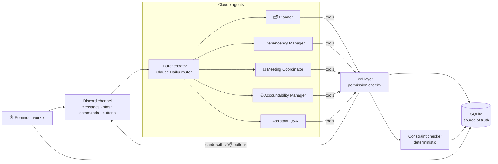

# MergeMates 🤝 — the AI project manager inside your group chat

> **Your group project finally has a project manager. And nobody has to be it.**

MergeMates is a Discord bot powered by **Claude** that joins a student group's project channel and turns messy chat — *"I'll do the slides"*, *"can we meet Thursday?"*, *"wait, who's submitting?"* — into a coordinated plan. It assigns work **only after people confirm**, tracks who's blocked by whom, finds meeting times around everyone's classes, sends dependency-aware reminders, and makes sure the project is actually submitted.

Tag **@MergeMates** with any question and Claude answers in the channel, with full knowledge of the project.

---

## Why students say "we need this"

| Every group project | With MergeMates |
|---|---|
| One person ends up as the unpaid PM | The bot is the PM; nobody nags anybody |
| "Who's doing the report?" scrolls away | Commitments become tracked tasks after a one-click confirm |
| Maya waits on Alex and finds out the night before | Dependency warnings 24h *before* the blocker's deadline, and an instant ping when it's done |
| 40 messages to find a meeting time | `/meet` checks everyone's class schedule (privately) and proposes the 5 best slots |
| "I thought *you* submitted it" | A designated submitter must explicitly confirm; the bot checks the rubric first |

---

## Architecture



**Stack:** Node.js 20+ · TypeScript · discord.js v14 · Anthropic SDK (Claude Sonnet for agents, Claude Haiku for routing) · SQLite (better-sqlite3) · chrono-node + luxon for dates · Vitest.

### The multi-agent design (what judges asked for)

**What agents share.** Agents never re-read the whole chat. Each run gets a compact **structured state snapshot** from the database — members, rubric requirements, tasks with owners/deadlines/status, the dependency graph, meetings and pending proposals — plus the last few messages. When several agents run for one message they run **in sequence over the same live database**, so the second agent sees what the first created, and they can pass **hand-off notes** (e.g. Planner → Dependency Manager: *"slides depend on research"*).

**How they handle conflicting constraints.** Every proposal from any agent passes through one deterministic **constraint checker** (`src/core/constraints.ts`) that knows about:
- dependency hand-off time (a dependent task needs ≥12h after its blocker),
- circular dependencies (refused outright),
- the final project deadline,
- member overload (3+ tasks due within 48h),
- confirmed team meetings that a slipped deadline would affect,
- everyone's class schedules (meeting slots are scored by how many people are free).

Conflicts are returned to the agent inside the tool result so Claude can revise (pick someone with more capacity, a different date) and are also printed on the confirmation card under **⚠️ Heads-up**, so students decide with full information. Example: Alex can't finish research by Wednesday → the Dependency Manager sees Maya's slides are squeezed and tomorrow's meeting is affected, and proposes either a deadline change (Alex *and* Maya must approve) or a reassignment to the teammate with the lightest load.

**When they ask students to confirm.** AI output is a proposal, never a fact. Code — not the prompt — enforces:

| Action | Who must confirm |
|---|---|
| Assign a task to someone | That person (button or "confirmed" in chat) |
| Your own commitment ("I'll do research") | Nobody else — your words are your consent |
| Reassign a task | New owner + current owner |
| Move a deadline that others depend on | Owner + every blocked teammate |
| Lock a meeting slot | Everyone who voted but didn't pick that slot |
| Mark a task done | Only its owner |
| Project submitted | Only the designated submitter, explicitly |
| Class schedule | Only you, for yourself (labels never shown to others) |

Every agent action is written to `agent_log` and mirrored live to **#mergemates-log**, and `/agents` shows the trail — a glass-box view of the system.

---

## Features

- **Task orchestration from chat** — passive listening (cheap regex pre-filter → Haiku router) picks up commitments without being tagged; toggle with `/settings listen`.
- **Rubric → plan** — upload a PDF/text/photo rubric; Claude reads it natively, records graded requirements, and posts a **claim board** of deliverables with milestone dates.
- **Dependencies & blockers** — blocked tasks are marked, owners are told the moment they're unblocked, and risks surface 24h early.
- **Group scheduling** — recurring class schedules (`/classes add TTh 1:30pm 2:45pm`) feed a slot finder; vote with buttons, lock in, get an `.ics` calendar invite and reminders.
- **Smart reminders** — per-person frequency (minimal / normal / frequent), optional DM delivery, dependency-risk warnings, overdue check-ins with *Done / Need more time / Need help* buttons, meeting reminders. Every reminder re-checks live state before firing, so nobody gets nagged about something already finished.
- **Rescue mode** — `/rescue` runs the Dependency + Accountability agents to propose a recovery plan.
- **Submission guardian** — readiness checks 48h/24h/3h before the deadline, rubric coverage, and an explicit submitter confirmation (with optional proof/screenshot). "It's ready" never counts as submitted.
- **Ask Claude anything** — `@MergeMates` or `/ask` for project questions ("what's blocking us?") or general help (concepts, writing, study tips).

### Commands

`/setup` `/rubric` `/join` `/status` `/tasks` `/mytasks` `/blocked` `/task` `/claim` `/done` `/deadline` `/depends` `/meet` `/classes add|list|clear` `/rescue` `/readiness` `/submitter` `/submitted` `/settings` `/ask` `/agents` `/help`

---

## Setup (≈10 minutes)

### 1. Create the Discord bot
1. Go to <https://discord.com/developers/applications> → **New Application** → name it `MergeMates`.
2. **Bot** tab → **Reset Token** → copy it (this is `DISCORD_TOKEN`).
3. Same tab → **Privileged Gateway Intents** → turn on **Message Content Intent** and **Server Members Intent** → Save.
4. **General Information** → copy **Application ID** (`DISCORD_CLIENT_ID`).

### 2. Create the server and invite the bot
1. In Discord: **+** → **Create My Own** → name it (e.g. *MergeMates Hackathon*). Bots can't create servers on your behalf, so this one click is yours.
2. Turn on **User Settings → Advanced → Developer Mode**, right-click the server icon → **Copy Server ID** (`DISCORD_GUILD_ID`).
3. Invite the bot (replace `YOUR_CLIENT_ID`):
   ```
   https://discord.com/oauth2/authorize?client_id=YOUR_CLIENT_ID&scope=bot%20applications.commands&permissions=274878032976
   ```
   (That's View/Send/Embed/Attach/Read History/Manage Channels/Manage Messages/Threads. For a throwaway hackathon server, `permissions=8` — Administrator — also works.)

### 3. Get a Claude API key
<https://console.anthropic.com> → **API Keys** → create one (`ANTHROPIC_API_KEY`).

### 4. Install and run
```bash
cp .env.example .env        # fill in the four values above
npm install
npm run setup-server -- --project "CSE 360 Team Project" --deadline "Dec 5 11:59pm" --course "CSE 360"
npm run dev                 # or: npm run build && npm start
```
`setup-server` builds the channels (`#welcome`, `#project-chat`, `#mergemates-log`, 🔊 `study-room`), pins a guide, registers slash commands, and (with `--project`) binds the project to `#project-chat`. You can skip it and run `/setup` in any channel instead. Slash commands are also registered automatically every time the bot starts.

### 5. Deploy so reminders fire 24/7
**Railway:** New Project → Deploy from GitHub (or `railway up`) → add the env vars → add a **Volume** mounted at `/app/data` and set `DATABASE_PATH=/app/data/mergemates.db`. The included `Dockerfile` builds and runs it; `PORT` enables a health check.
**Render:** Background Worker (or Web Service with `PORT`) with a persistent disk at `/app/data`.

---

## Demo script (≈4 minutes)

1. **Setup** — `/setup name:"CSE 360 Project" deadline:"next Friday 11:59pm" rubric:<PDF> submitter:@Sam`. Claude reads the rubric, lists requirements, and posts the claim board. Two teammates click to claim.
2. **Natural assignment** — Alex: *"I'll handle research, Maya can do slides, Sam does testing."* → Alex's task is recorded; Maya and Sam get ✅/✋ cards.
3. **Dependency** — Maya: *"I can do slides but I need Alex's research by Wednesday."* → Maya confirms, dependency recorded, slides marked blocked. Alex: *"@MergeMates confirmed, Wednesday 6 PM."*
4. **Scheduling** — everyone `/classes add …`, then *"@MergeMates can we meet Thursday?"* → poll with 🟢/🟡 slots → vote → lock → calendar invite.
5. **The standout moment** — Alex: *"@MergeMates I'm sick, can't finish research by Wednesday."* → Dependency Manager flags that Maya is blocked and Thursday's meeting is affected, and proposes a deadline change or reassignment with a ⚠️ heads-up; the affected people approve with buttons. Show **#mergemates-log** to reveal each agent's tool calls and conflict checks.
6. **Reminders** — show a real reminder firing (create a task due in ~25 minutes with `/settings reminders:frequent`, or lower `SCHEDULER_INTERVAL_SECONDS`), then `/status` and `/readiness`, then Sam runs `/submitted`.

---

## Data model (SQLite, `src/db/index.ts`)

`projects` (channel, deadline, timezone, rubric, submitter, submission proof) · `members` (reminder prefs, DM opt-in) · `requirements` (rubric items) · `tasks` (owner, due, status: proposed → confirmed → in_progress/blocked → done/overdue/declined, source message) · `dependencies` · `busy_blocks` (private recurring class times) · `meetings` + `meeting_votes` · `decisions` (every consent-gated proposal with approvers, approvals, conflicts) · `reminders` (deduplicated, re-validated at fire time) · `agent_log` · `chat_log` (last 300 messages per project, for context).

## Development

```bash
npm test          # 25 tests: time parsing, slot finding, consent flows, ripple conflicts,
                  # reminder engine, multi-agent orchestration with a scripted fake Claude, Discord cards
npm run typecheck
```
Models are configurable via `CLAUDE_MODEL` / `CLAUDE_FAST_MODEL`.

## Privacy

Class schedule labels are never posted — meeting suggestions only use free/busy. Reminders can be DM-only. Passive listening can be turned off so the bot only reads messages when tagged. Chat context sent to Claude is limited to the project channel's recent messages.
